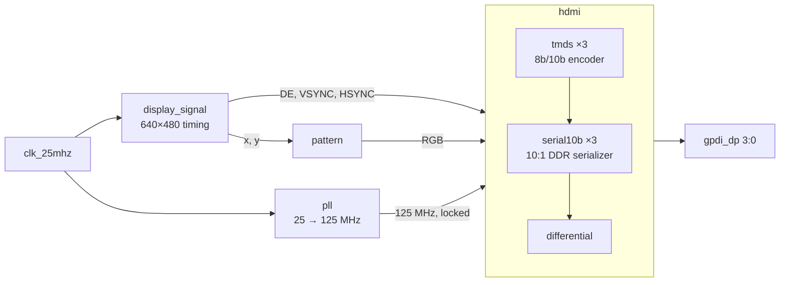

# ULX3S HDMI output

DVI/HDMI video output for the [ULX3S](https://radiona.org/ulx3s/) board (Lattice ECP5 LFE5U-85F):
a 640×480 @ 60 Hz test pattern (red ramps across x, blue down y), TMDS-encoded
and serialized directly by the FPGA onto the board's GPDI connector.

## Design



| File | Role |
|---|---|
| `rtl/top.sv` | Board top level: LEDs (`led[0]` = PLL locked), HDMI pins |
| `rtl/steer.sv` | Wires the video pipeline together; holds the HDMI block in reset until the PLL locks |
| `rtl/pll.sv` | ECP5 `EHXPLLL`, 25 MHz → 125 MHz (generated with `ecppll -i 25 -o 125`, do not edit) |
| `rtl/display_signal.sv` | Raster counters and sync/display-enable generation, parameterized timing and polarity |
| `rtl/pattern.sv` | Gradient pattern: `r = x·255/H_RES`, `g = 0`, `b = y·255/V_RES` |
| `rtl/hdmi.sv` | Input pipeline, three TMDS encoders, three serializers; lane 3 carries the pixel clock |
| `rtl/tmds.sv` | TMDS encoder (DVI 1.0 §3.2.2) with running-disparity DC balance and control tokens |
| `rtl/serial10b.sv` | 10:1 serializer: 5× serial clock with `ODDRX1F` DDR output |
| `rtl/differential.sv` | Output buffer; the negative pins come from the `LVCMOS33D` I/O type in the `.lpf` |
| `rtl/bram.sv` | Generic simple dual-port RAM (read-first, optional `$readmemh` init); not instantiated |
| `ulx3s_v20.lpf` | ULX3S v2.0 pin constraints |

## Requirements

| Task | Tools |
|---|---|
| Simulation | [Verilator](https://verilator.org) ≥ 5.052, `make`, a C++17 compiler |
| Coverage | Verilator, [info-process](https://github.com/antmicro/info-process), Python 3 |
| Coverage dashboard | the above plus `git`, Node.js/npm ([Coverview](https://github.com/antmicro/coverview) is built from source) |
| Bitstream | `yosys`, `nextpnr-ecp5`, `ecppack` ([OSS CAD Suite](https://github.com/YosysHQ/oss-cad-suite-build)) |
| Programming | `fujprog` |

## Simulation

Every RTL file has a self-checking testbench in `tbs/` that exits non-zero on the first failed check.

```sh
make test                # all testbenches
make test-tmds           # one testbench (tbs/tb_<name>.sv)
make test-hdmi WAVES=1   # also dump build/tb_hdmi.vcd
make wave T=hdmi         # open it in gtkwave
```

| Testbench | Checks |
|---|---|
| `tb_tmds` | Bit-exact against a reference encoder written from the DVI spec; decode round trip; disparity reset |
| `tb_serial10b` | Back-to-back LSB-first framing at 7 serial/pixel clock phase offsets; reset |
| `tb_differential` | Pass-through |
| `tb_bram` | Init file, read latency, read-during-write, random traffic on 16×8 and 64K×16 instances |
| `tb_display_signal` | Cycle-by-cycle against a raster model (640×480, a tiny raster, defaults); sync widths and polarity |
| `tb_pattern` | Formula over every visible x and y at 640×480 and 1024×768 |
| `tb_pll` | 125 MHz, 50 % duty, phase-aligned, locks (through the PLL model) |
| `tb_hdmi` | Decodes all lanes back to the input pixels; constant, equal latency on all lanes |
| `tb_steer` | Decodes one full frame from the pins and checks VESA 640×480 timing and every pixel |
| `tb_top` | LED pattern, PLL-lock LED, pin connectivity |

Shared test code:

- `tbs/tmds_ref.sv`: reference TMDS encoder/decoder and control tokens
- `tbs/tmds_rx.sv`: lane receiver that word-aligns a serial lane on control tokens
- `tbs/models/`: behavioural simulation models of the ECP5 primitives `ODDRX1F` and `EHXPLLL`
  (yosys only ships blackboxes). The PLL model enforces the ECP5 PFD/VCO/output frequency ranges.

## Coverage

```sh
pip install git+https://github.com/antmicro/info-process.git
make coverage        # build/coverage/coverview.zip + summary.md
make coverage-html   # build/coverage/index.html (standalone dashboard)
```

`make coverage` reruns every testbench with Verilator `--coverage`, exports line, branch,
toggle and expression coverage for `rtl/` only, merges it per type with the list of
testbenches that hit each line, and packs a [Coverview](https://github.com/antmicro/coverview)
archive. Load `coverview.zip` into <https://antmicro.github.io/coverview/>, or open
`index.html` from `make coverage-html`, which embeds the data into a single file.

## Bitstream

```sh
make bitstream   # ulx3s.bit
make prog        # program the board with fujprog
```

## CI

`.github/workflows/ci.yml` runs on every push and pull request:

1. **Testbenches**: `make test`.
2. **Coverage (Coverview)**: `make coverage-html`. The coverage table goes into the job summary,
   and `index.html`, `coverview.zip` and `summary.md` are uploaded as the `coverage` artifact.
3. **Deploy coverage to GitHub Pages**: on pushes (and manual runs) of the default branch, the
   same files are published to GitHub Pages, so the dashboard is at
   `https://<owner>.github.io/<repo>/`. Requires *Settings → Pages → Source: GitHub Actions*.

Verilator is built from source by `.github/actions/setup-verilator` and cached per version.
Verilator, info-process and Coverview versions are pinned in the workflow and the `Makefile`.

## Notes

- Compiler temporary files go to `build/tmp` (`make test` / `make coverage` set `TMPDIR`), so a
  small or full `/tmp` does not break the build. The bitstream flow does not do this; if yosys
  fails writing to `/tmp`, run `mkdir -p build/tmp && TMPDIR=$PWD/build/tmp make bitstream`.
- `make clean` removes `build/` and the bitstream outputs.
