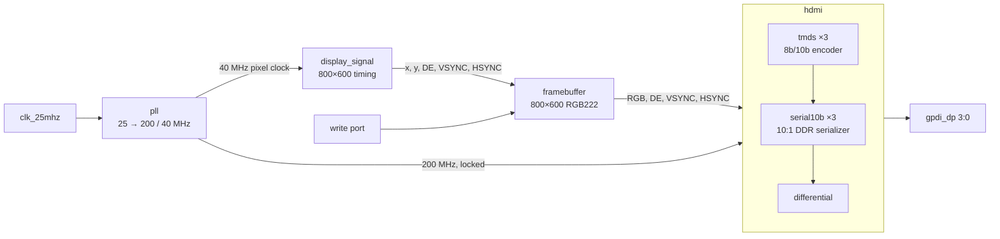

# ULX3S HDMI output

DVI/HDMI video output for the [ULX3S](https://radiona.org/ulx3s/) board (Lattice ECP5 LFE5U-85F):
an 800×600 @ 60 Hz frame buffer of 64 colours (RGB222) in block RAM, TMDS-encoded
and serialized directly by the FPGA onto the board's GPDI connector.

## Design



| File | Role |
|---|---|
| `rtl/top.sv` | Board top level: LEDs (`led[0]` = PLL locked), HDMI pins; frame buffer write port tied off |
| `rtl/steer.sv` | Wires the video pipeline together; holds the HDMI block in reset until the PLL locks; exposes the frame buffer write port |
| `rtl/pll.sv` | ECP5 `EHXPLLL`, 25 MHz → 200 MHz serial (CLKOP) + 40 MHz pixel (CLKOS), phase-aligned (generated with `ecppll -i 25 -o 200 --clkout1 40`, do not edit) |
| `rtl/display_signal.sv` | Raster counters and sync/display-enable generation, parameterized timing and polarity |
| `rtl/framebuffer.sv` | W×H RGB222 frame buffer: row-major `y*W + x`, 2-pixel-clock read latency with `hve` delayed to match, independent-clock write port |
| `rtl/hdmi.sv` | Input register, three TMDS encoders, three serializers; lane 3 carries the pixel clock. 4 pixel clocks from `hve`/`rgb` to the serializers |
| `rtl/tmds.sv` | TMDS encoder (DVI 1.0 §3.2.2) with running-disparity DC balance and control tokens; 3-stage pipeline (q_m, disparity, running-disparity/output) |
| `rtl/serial10b.sv` | 10:1 serializer: 5× serial clock with `ODDRX1F` DDR output |
| `rtl/differential.sv` | Output buffer; the negative pins come from the `LVCMOS33D` I/O type in the `.lpf` |
| `rtl/bram.sv` | Simple dual-port RAM: separate write/read clocks, any `DEPTH`, read-first, optional `$readmemh` init |
| `scripts/fb_image.py` | Writes the power-up frame buffer image (`build/fb_init.hex`): built-in 64-colour test image, or a picture dithered to RGB222 |
| `ulx3s_v20.lpf` | ULX3S v2.0 pin constraints |

### Frame buffer

- 800×600 pixels × 6 bits = 2.88 Mbit in 157 of the 208 DP16KD block RAMs (177 once a writer drives the write port).
- Pixel byte layout: `{r1 r0 g1 g0 b1 b0}`; each 2-bit channel is expanded to 8 bits as `00, 55, AA, FF`.
- Write port on `steer`: `i_fb_wclk`, `i_fb_we`, `i_fb_waddr` (`y*800 + x`), `i_fb_wdata`, in any clock domain.
  Writes are not synchronised to the raster, so changing the visible frame can tear.
- Power-up image: `make bitstream` generates the test image (64 colour cells and a 1-pixel white border);
  `make bitstream FB_IMAGE=photo.png` converts a picture instead (Python Pillow, scaled to 800×600,
  Floyd–Steinberg dithered). `make` only regenerates `build/fb_init.hex` when the script or picture is
  newer, so delete it after switching `FB_IMAGE` (or back to the test image).

## Requirements

| Task | Tools |
|---|---|
| Simulation | [Verilator](https://verilator.org) ≥ 5.052, `make`, a C++17 compiler, Python 3 (frame buffer image) |
| Coverage | Verilator, [info-process](https://github.com/antmicro/info-process), Python 3 |
| Coverage dashboard | the above plus `git`, Node.js/npm ([Coverview](https://github.com/antmicro/coverview) is built from source) |
| Bitstream | `yosys`, `nextpnr-ecp5`, `ecppack` ([OSS CAD Suite](https://github.com/YosysHQ/oss-cad-suite-build)), Python 3; Pillow only for `FB_IMAGE` |
| Programming | `fujprog` |

## Simulation

Every RTL file has a self-checking testbench in `tbs/` that exits non-zero on the first failed check.

```sh
make test                # all testbenches
make test-tmds           # one testbench (tbs/tb_<name>.sv)
make test-hdmi WAVES=1   # also dump build/tb_hdmi.vcd
make wave T=hdmi         # open it in gtkwave
```

| Testbench | Checks |
|---|---|
| `tb_tmds` | Bit-exact against a reference encoder written from the DVI spec at the 3-cycle pipeline latency; decode round trip; disparity reset; reset flushes words in flight |
| `tb_serial10b` | Back-to-back LSB-first framing at 7 serial/pixel clock phase offsets; reset |
| `tb_differential` | Pass-through |
| `tb_bram` | Init file, read latency, read-during-write, random traffic on 16×8 and 64K×16 instances |
| `tb_framebuffer` | 10×3 frame with an init file and unrelated pixel/write clocks: rgb and hve latency, RGB222 expansion, addressing over raster and random visits, writes read back |
| `tb_display_signal` | Cycle-by-cycle against a raster model (800×600 as in steer, 640×480 negative syncs, a tiny raster, defaults); sync widths and polarity |
| `tb_pll` | 200 MHz CLKOP and 40 MHz CLKOS, 50 % duty, phase-aligned to each other and the input, locks (through the PLL model) |
| `tb_hdmi` | Decodes all lanes back to the input pixels; constant, equal latency on all lanes |
| `tb_steer` | Decodes one full frame from the pins and checks VESA 800×600@60 timing (positive syncs) and every pixel against the frame buffer image, including pixels written through the write port |
| `tb_top` | LED pattern, PLL-lock LED, pin connectivity, clock lane is the pixel clock |

Shared test code:

- `tbs/tmds_ref.sv`: reference TMDS encoder/decoder and control tokens
- `tbs/tmds_rx.sv`: lane receiver that word-aligns a serial lane on control tokens
- `tbs/models/`: behavioural simulation models of the ECP5 primitives `ODDRX1F` and `EHXPLLL`
  (yosys only ships blackboxes). The PLL model enforces the ECP5 PFD/VCO/output frequency ranges.

## Coverage

```sh
pip install git+https://github.com/antmicro/info-process.git
make coverage        # build/coverage/coverview.zip + summary.md
make coverage-html   # build/coverage/index.html (standalone dashboard)
```

`make coverage` reruns every testbench with Verilator `--coverage`, exports line, branch,
toggle and expression coverage for `rtl/` only, merges it per type with the list of
testbenches that hit each line, and packs a [Coverview](https://github.com/antmicro/coverview)
archive. Load `coverview.zip` into <https://antmicro.github.io/coverview/>, or open
`index.html` from `make coverage-html`, which embeds the data into a single file.

## Bitstream

```sh
make bitstream   # ulx3s.bit
make prog        # program the board with fujprog
```

## CI

`.github/workflows/ci.yml` runs on every push and pull request:

1. **Testbenches**: `make test`.
2. **Coverage (Coverview)**: `make coverage-html`. The coverage table goes into the job summary,
   and `index.html`, `coverview.zip` and `summary.md` are uploaded as the `coverage` artifact.
3. **Deploy coverage to GitHub Pages**: on pushes (and manual runs) of the default branch, the
   same files are published to GitHub Pages, so the dashboard is at
   `https://<owner>.github.io/<repo>/`. Requires *Settings → Pages → Source: GitHub Actions*.

Verilator is built from source by `.github/actions/setup-verilator` and cached per version.
Verilator, info-process and Coverview versions are pinned in the workflow and the `Makefile`.

## Notes

- Compiler and tool temporary files go to `build/tmp` (`make test`, `make coverage` and
  `make bitstream` set `TMPDIR`), so a small or full `/tmp` does not break the build.
- `make clean` removes `build/` and the bitstream outputs.
